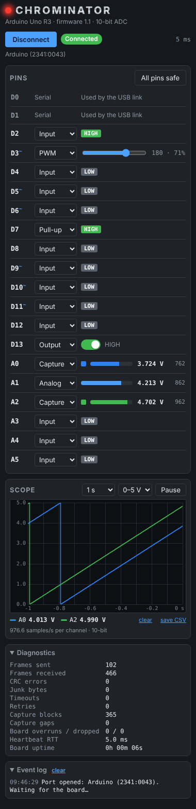

# Chrominator

*"I'll be back… once you reconnect the USB."*

A Chrome / Edge extension that turns an Arduino (**Nano R4** or Uno R3) into a debugging tool you can drive from the
browser's side panel while you browse. Pick the board's port once, then set pin modes, switch
outputs, drive PWM and watch digital inputs and analog voltages live. A heartbeat watches the
link the whole time, and the board drops every pin to a safe state if the browser goes away.



## What's here

| Folder | Contents |
|---|---|
| `extension/` | The Chrome extension (Manifest V3, side panel). |
| `firmware/Chrominator/` | Arduino sketch for the board (Nano R4, Uno R3; Uno R4 untested). |
| `docs/PROTOCOL.md` | The serial protocol: framing, commands, heartbeat and failsafe. |
| `test/` | End-to-end tests: the real firmware, compiled for the PC, against the extension's link code. |

## Set up

**1. Flash the board** (Arduino IDE 2.x)
1. Open `firmware/Chrominator/Chrominator.ino`.
2. Board: **Arduino Nano R4** (install *Arduino UNO R4 Boards* in the Boards Manager first), or **Arduino Uno**. Port: the board's COM port.
3. Upload. Then close the IDE's Serial Monitor; only one program can use the port at a time.

**2. Install the extension** (one time)
1. Go to `chrome://extensions` (or `edge://extensions`) and turn on **Developer mode**.
2. Click **Load unpacked** and select the `extension` folder.
3. Pin **Chrominator** from the puzzle-piece menu.

## Use

1. Click the Chrominator icon (the red eye) to open the side panel.
2. Click **Connect**. The first time, a tab opens: click **Choose serial port…** and pick your
   Arduino. After that, Connect goes straight to the same board; use *Choose a different port…*
   to switch.
3. The Nano R4 answers at once. An Uno R3 resets when the port opens, so allow about two seconds before its pins appear.

| Mode | What you get |
|---|---|
| Input / Pull-up | Live HIGH/LOW level |
| Output | On/off switch; shows `reads LOW!` if the pin doesn't follow (short or overload) |
| PWM (pins marked ~) | Slider, 0–255 |
| Analog (A0–A7 on the Nano R4, A0–A5 on the Uno) | Voltage (5 V reference), raw reading (14-bit on the Nano R4, 10-bit on the Uno) and a bar |
| Oscilloscope (A0–A7 Nano R4, A0–A5 Uno) | The pin is sampled continuously (100 times a second on the Nano R4, ~1000 on the Uno) and drawn on the **Oscilloscope** panel; its row is greyed out, and the ✕ next to its trace stops it (back to Analog) |

**Oscilloscope.** The Oscilloscope panel sits at the top, above the pins. When Chrominator connects,
it puts **A0 and A1** on the oscilloscope straight away (if they're plain inputs); change them as you like after that. Put one or more analog pins in
**Oscilloscope** mode and their waveforms are drawn there in roll mode (newest sample at the right edge,
the trace moving left), overlaid, each in its pin's colour: A0–A7 carry the same colour in the
pin list. The board samples all capturing pins at the same instant: 100 times a second with full
14-bit readings on the Nano R4 (sent in 8-sample blocks), 976.6 times a second at 10 bits on the
Uno (32-sample blocks). The time axis comes from the board's clock, not the PC's. Step the timebase with **◀ / ▶** (1 s to 2 min
across the screen), a fixed 0–5 V or *Auto* vertical scale, **Pause** to freeze the picture
(capture carries on underneath), the **V** next to each trace to show its live voltage (off by default, since a fast signal
just makes the number flicker; remembered per channel), and **save CSV** to export everything held (about the last
2 minutes per channel). It is meant for slow signals, such as a battery voltage sagging after
it's disconnected, not as a fast oscilloscope.

**UART.** Above the I²C Port, the Nano R4's UART (`Serial1`): **RX on D0**, **TX on D1**. RX and TX
are independent: pick **UART RX** in D0's dropdown or **UART TX** in D1's (or use the panel's RX/TX
switches), and the other pin stays an ordinary pin for anything else, since often only TX is used.
In UART mode the pin's label turns **green (RX)** or **red (TX)**. Set the baud (up to 115200) and
format (8N1, 8N2, 8E1, 8E2, 8O1, 8O2) in the panel, and click **Terminal…** for a terminal window,
Tera Term style: data sent on TX in red, data received on RX in green, a Text/Hex view, and a send
box (Enter to send, with a choice of line ending, or raw hex bytes). Tick **Live** to send each key
the moment it's typed: Enter sends the line ending, Backspace 0x08, Ctrl+letter the control code
(Ctrl+C = 0x03), arrow keys their escape sequences, and a paste goes out at once. (On the Uno R3, D0/D1 carry the
USB link, so there is no free UART.)

**I²C Port and SPI Port.** Below the pins, each bus has its own panel: switch on **I²C** (SDA A4,
SCL A5) or **SPI** (SCK D13, MOSI D11, MISO D12, SS D10). The bus's pins are put back to plain inputs, greyed out in the pin list and
labelled with their role until the bus is switched off. The role (Master or Slave), clock, mode and
bit-order settings are there, but sending and receiving data isn't implemented yet.

**Pop out (A0, A1).** While A0 or A1 is in Oscilloscope mode its row has a **Pop out** button
that opens that channel in its own resizable oscilloscope window, with its own timebase, scale, Pause and
save CSV. Click **📌 Keep on top** in that window to turn it into a Picture-in-Picture window, which
**stays on top** of the browser (and other programs) while you work. The channel keeps drawing in the side panel too. Chrome allows one
Picture-in-Picture window at a time: keeping a second channel on top hands the first one back to
its regular window.

Disconnecting (or unplugging the board) closes all pop-out windows: oscilloscope windows, the
always-on-top window and the UART terminal.

**Generator.** Right under the Oscilloscope, a placeholder for the Nano R4's 12-bit DAC on A0. It has no
controls yet.

**Light / dark.** The ☀ Light / ☾ Dark switch next to Connect sets the colour theme and is remembered.
Dark is the default.

Every panel folds up: click its heading (Oscilloscope, Generator, Pins, UART, I²C Port, SPI Port, Diagnostics, Event log). Chrominator
remembers which ones you folded.

**Net names.** Each pin row ends with a box where you can type what the pin is wired to (up to 16
characters, e.g. `VBAT`, `LED_EN`); press Enter to keep it. Names are remembered per board type, and
A0–A7 names also label their traces on the Oscilloscope and the columns of the saved CSV.

**All pins safe** puts every pin back to a plain input. On the Nano R4, D0/D1 are ordinary pins (its USB is native). On the Uno, D0/D1 carry the USB serial link and
can't be used.

**Status:** the red eye pulses with each heartbeat and the round-trip time shows on the right.
*Link lost* means the board stopped answering for a second (the port is still open and the
extension keeps trying). If the board hears nothing from the extension for 1.5 s it sets every
pin to input on its own, so an output is never left driving while nobody is watching.
*Diagnostics* shows frame counts, CRC errors, timeouts and retries.

## Test

```sh
test/run.sh          # needs g++ and Node 20+
```

This compiles the real firmware against a simulated Arduino (`test/sim`), once with the Uno R3 pin map and once with the Nano R4 pin map (`test/nanor4.test.mjs`), and runs it against the
extension's `protocol.js` and `link.js`: connection, every command and error status, the
heartbeat, corrupted bytes, link loss and recovery, the board's failsafe, a board reboot, and
capture (block alignment between channels, all six channels streaming at once, stopping).
